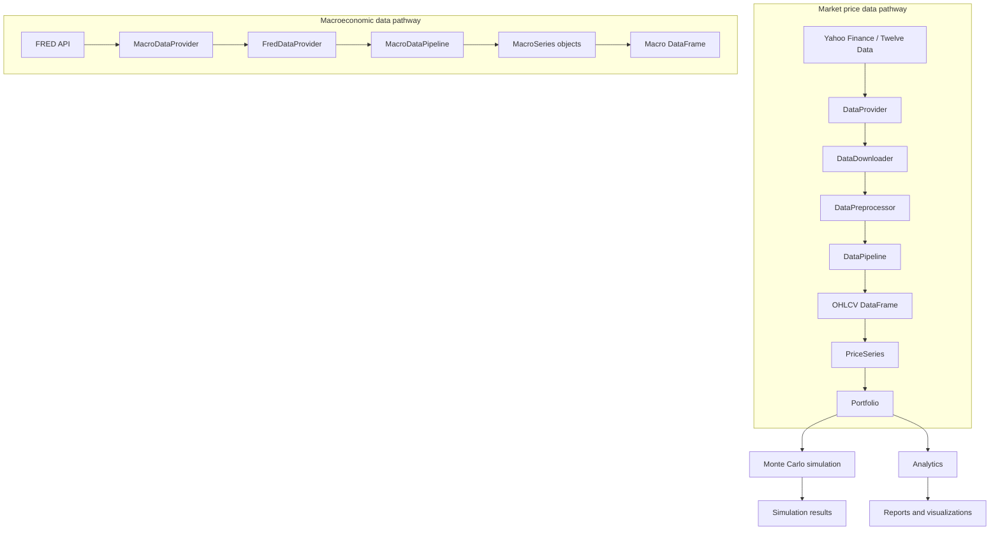
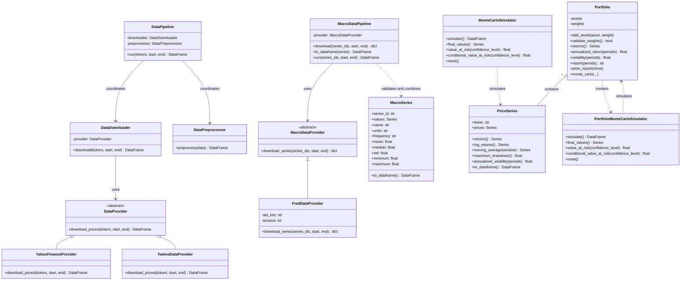

# Financial Toolkit — Architecture

## 1. Overview

Financial Toolkit is a modular Python library designed to retrieve, preprocess, model, simulate, and analyze financial market data, macroeconomic time series, and portfolios.

The project follows a layered architecture that separates data ingestion, financial modeling, simulation, and analytics. It also maintains independent data pathways for market prices and macroeconomic indicators, since they have different structures and analytical purposes.

The source code is organized under `src/Financial_toolkit`.

## 2. Package structure

```text
src/Financial_toolkit/
├── analytics/
│   ├── plots.py
│   └── reports.py
├── cli/
│   ├── banners.py
│   ├── formatting.py
│   └── interface.py
├── data/
│   ├── company_universe.py
│   ├── downloader.py
│   ├── macro_pipeline.py
│   ├── macro_providers.py
│   ├── pipeline.py
│   ├── preprocessing.py
│   └── providers.py
├── models/
│   ├── macro_series.py
│   ├── portfolio.py
│   └── price_series.py
├── simulation/
│   └── monte_carlo.py
└── utils/
    └── validators.py
```

### 2.1 Data layer

The data layer contains two independent ingestion pathways.

**Market price data**

Responsible for retrieving and standardizing financial market price data.

- `DataProvider`: abstract interface defining the market data provider contract.
- `YahooFinanceProvider`: retrieves market data through Yahoo Finance.
- `TwelveDataProvider`: retrieves market data through the Twelve Data API.
- `DataDownloader`: validates download parameters and coordinates provider calls.
- `DataPreprocessor`: cleans, validates, deduplicates, and sorts downloaded observations.
- `DataPipeline`: orchestrates downloading and preprocessing.

Market price data follows a standardized OHLCV-oriented schema:

- `ticker`: instrument symbol.
- `date`: trading date.
- `open`, `high`, `low`, `close`: price fields.
- `adj_close`: adjusted closing price.
- `volume`: traded volume.

The provider abstraction allows additional market data sources to be integrated without changing the downstream processing logic.

**Macroeconomic data**

A separate pathway retrieves and organizes macroeconomic time series from FRED (Federal Reserve Economic Data).

- `MacroDataProvider`: abstract interface defining the macroeconomic provider contract.
- `FredDataProvider`: retrieves one or more macroeconomic series through the FRED observations API.
- `MacroDataPipeline`: coordinates downloads, validates returned `MacroSeries` objects, and combines them into a tabular dataset.

The macroeconomic pathway uses its own normalized schema:

- `series_id`: FRED series identifier.
- `date`: observation date.
- `value`: numeric observation.

`MacroDataPipeline` can combine multiple series into a single DataFrame. Missing observations represented by FRED as `.` are excluded during ingestion.

This pathway is intentionally independent of the market price pipeline. Macroeconomic observations are not treated as OHLCV records or automatically passed into the portfolio models.

### 2.2 Models layer

Responsible for representing financial data and portfolio structures.

- `PriceSeries`: represents a financial instrument's price history, metadata, and derived statistics.
- `MacroSeries`: represents a macroeconomic indicator as a dated numerical series and calculates descriptive statistics, including mean, median, standard deviation, minimum, and maximum.
- `Portfolio`: manages assets and weights, calculates portfolio returns and risk metrics, and exposes reporting, plotting, and Monte Carlo functionality.

`Portfolio` uses `PriceSeries` objects as its underlying asset representation. `MacroSeries` is a separate model for macroeconomic observations.

### 2.3 Simulation layer

Responsible for stochastic financial modeling.

- `MonteCarloSimulator`: simulates individual asset price trajectories using a Geometric Brownian Motion model.
- `PortfolioMonteCarloSimulator`: simulates portfolio trajectories using correlated asset returns and portfolio weights.

Both simulators support reproducibility through configurable random seeds and expose risk measures such as Value at Risk and Conditional Value at Risk.

### 2.4 Analytics layer

Responsible for communicating portfolio results.

- `reports.py`: generates configurable Markdown portfolio reports with metrics, diagnostics, and warnings.
- `plots.py`: generates comparative portfolio visualizations, including returns, correlations, and portfolio evolution.

The `Portfolio` class provides the public methods `report()` and `plots_report()` to access these capabilities.

### 2.5 Utilities layer

Contains shared validation and support functionality used across the package.

The `cli` package provides the interactive command-line interface, including presentation, formatting, and user interaction components.

## 3. Component architecture

The following diagram illustrates the two independent data ingestion pathways and the portfolio analysis flow.



The market data pipeline produces standardized and cleaned OHLCV tabular data. `PriceSeries` objects can then represent individual instruments, which are assembled into a `Portfolio`.

The macroeconomic pipeline independently retrieves one or more FRED series and represents them as `MacroSeries` objects. It can combine these objects into a DataFrame with the columns `series_id`, `date`, and `value`.

The two pathways share the same architectural principle of provider abstraction and pipeline orchestration, but retain separate models and data schemas.

The portfolio can be analyzed directly or passed to the portfolio simulation engine.

## 4. UML class diagram



The diagrams represent the package's principal components and their relationships. Private implementation details and third-party dependencies are intentionally omitted.

## 5. Main execution workflows

### 5.1 Market data ingestion workflow

1. A client selects a provider implementing `DataProvider`.
2. `DataDownloader` validates the requested tickers and date range.
3. The provider retrieves the requested market observations.
4. `DataPreprocessor` validates and standardizes the resulting data.
5. `DataPipeline` returns the processed OHLCV dataset.

### 5.2 Macroeconomic data ingestion workflow

1. A client configures a FRED API key, either through the `FRED_API_KEY` environment variable or the provider constructor.
2. The client creates a `FredDataProvider`.
3. `MacroDataPipeline` receives the provider and the requested FRED series identifiers and date range.
4. `FredDataProvider` retrieves the observations through the FRED API.
5. Missing observations are excluded and the results are represented as `MacroSeries` objects.
6. `MacroDataPipeline` can return the individual series or combine them into a normalized DataFrame.

### 5.3 Portfolio analysis workflow

1. Market price histories are represented by `PriceSeries` objects.
2. Assets and their weights are added to a `Portfolio`.
3. The portfolio calculates returns and risk statistics.
4. Reports and plots provide analytical outputs.
5. Monte Carlo simulation estimates possible future portfolio trajectories and risk measures.

### 5.4 Index comparison workflow

1. `data/benchmarks.py` translates a common index name (`SP500`, `IBEX35`...) into each provider's symbol (`^GSPC` in Yahoo Finance, the `SPY` ETF in Twelve Data).
2. `download_index()` downloads it through the same `DataPipeline` used for assets and returns a `PriceSeries`.
3. `Portfolio.compare_to_benchmark()` returns a `BenchmarkComparison` dataclass computed over the dates both series share.
4. When the FRED analysis has downloaded CPIAUCSL, `compare_real_returns()` reuses `calculate_real_performance()` to compare portfolio and index in real terms.

## 6. Design principles

### Separation of concerns

Each package has a clearly defined responsibility. Market data retrieval, macroeconomic data retrieval, preprocessing, financial modeling, simulation, and reporting are independent modules.

### Abstraction and extensibility

The `DataProvider` and `MacroDataProvider` abstract classes decouple data ingestion from specific external APIs. New market or macroeconomic providers can be implemented without redesigning their respective pipelines.

### Input validation

Validation is performed at relevant boundaries to prevent invalid dates, malformed observations, inconsistent weights, and invalid simulation parameters from propagating through the system.

### Reproducibility

Monte Carlo simulators support configurable random seeds, enabling repeatable simulation results and reliable automated testing.

### Reusable financial models

`PriceSeries`, `MacroSeries`, and `Portfolio` encapsulate their respective data structures and operations, allowing the models to be reused by the components designed for them.

### Testability

The modular architecture enables isolated unit tests for market providers, macroeconomic providers, preprocessing, models, pipelines, simulations, and analytics.

## 7. Future extensibility

The architecture allows future extensions without requiring a redesign of the core package, including:

- Additional market data providers.
- Additional macroeconomic data providers.
- Fundamental data sources.
- Additional portfolio optimization methods.
- Alternative stochastic simulation models.
- Additional risk and performance metrics.
- New reporting and visualization formats.
