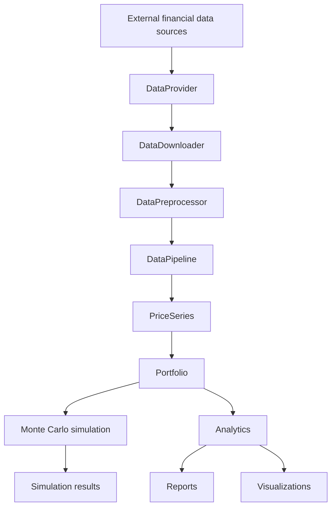
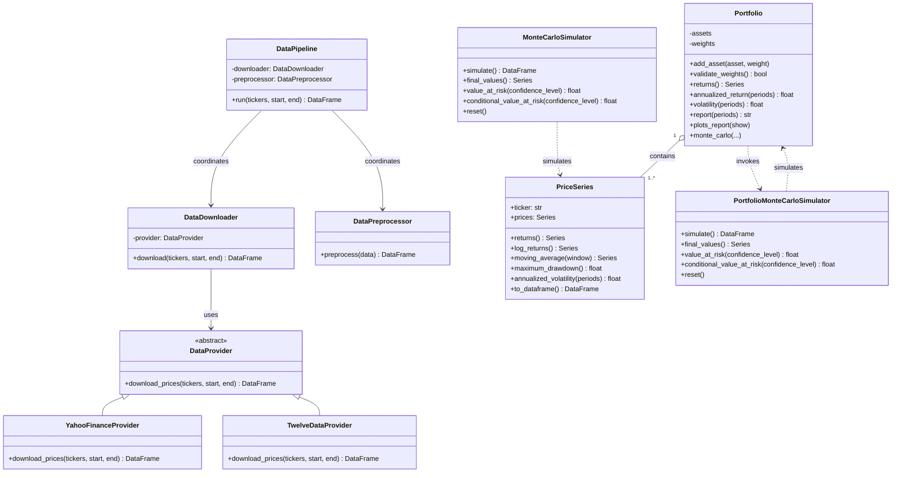

# Financial Toolkit — Architecture

## 1. Overview

Financial Toolkit is a modular Python library designed to retrieve, preprocess, model, simulate, and analyze financial time series and portfolios.

The project follows a layered architecture that separates data ingestion, financial modeling, simulation, and analytics. This separation improves maintainability, testability, and extensibility.

The source code is organized under `src/Financial_toolkit`.

## 2. Package structure

```text
src/Financial_toolkit/
├── analytics/
│   ├── plots.py
│   └── reports.py
├── data/
│   ├── downloader.py
│   ├── pipeline.py
│   ├── preprocessing.py
│   └── providers.py
├── models/
│   ├── portfolio.py
│   └── price_series.py
├── simulation/
│   └── monte_carlo.py
└── utils/
    └── validators.py
```

### 2.1 Data layer

Responsible for retrieving and standardizing financial market data.

- `DataProvider`: abstract interface defining the provider contract.
- `YahooFinanceProvider`: retrieves market data through Yahoo Finance.
- `TwelveDataProvider`: retrieves market data through the Twelve Data API.
- `DataDownloader`: validates download parameters and coordinates provider calls.
- `DataPreprocessor`: cleans, validates, deduplicates, and sorts downloaded observations.
- `DataPipeline`: orchestrates downloading and preprocessing.

The provider abstraction allows additional data sources to be integrated without changing the downstream processing logic.

### 2.2 Models layer

Responsible for representing financial data and portfolio structures.

- `PriceSeries`: represents a financial instrument's price history, metadata, and derived statistics.
- `Portfolio`: manages assets and weights, calculates portfolio returns and risk metrics, and exposes reporting, plotting, and Monte Carlo functionality.

`Portfolio` uses `PriceSeries` objects as its underlying asset representation.

### 2.3 Simulation layer

Responsible for stochastic financial modeling.

- `MonteCarloSimulator`: simulates individual asset price trajectories using a Geometric Brownian Motion model.
- `PortfolioMonteCarloSimulator`: simulates portfolio trajectories using correlated asset returns and portfolio weights.

Both simulators support reproducibility through configurable random seeds and expose risk measures such as Value at Risk and Conditional Value at Risk.

### 2.4 Analytics layer

Responsible for communicating portfolio results.

- `reports.py`: generates configurable Markdown portfolio reports with metrics, diagnostics, and warnings.
- `plots.py`: generates comparative portfolio visualizations, including returns, correlations, and portfolio evolution.

The `Portfolio` class provides the public methods `report()` and `plots_report()` to access these capabilities.

### 2.5 Utilities layer

Contains shared validation and support functionality used across the package.

## 3. Component architecture

The following diagram illustrates the main data flow and dependencies between layers.



The pipeline produces standardized and cleaned tabular data. `PriceSeries` objects can then represent individual instruments, which are assembled into a `Portfolio`.

The portfolio can be analyzed directly or passed to the portfolio simulation engine.

## 4. UML class diagram



The diagrams represent the package's principal public components and their relationships. Private implementation details and third-party dependencies are intentionally omitted.

## 5. Main execution workflows

### 5.1 Data ingestion workflow

1. A client selects a provider implementing `DataProvider`.
2. `DataDownloader` validates the requested tickers and date range.
3. The provider retrieves the requested observations.
4. `DataPreprocessor` validates and standardizes the resulting data.
5. `DataPipeline` returns the processed dataset.

### 5.2 Portfolio analysis workflow

1. Market price histories are represented by `PriceSeries` objects.
2. Assets and their weights are added to a `Portfolio`.
3. The portfolio calculates returns and risk statistics.
4. Reports and plots provide analytical outputs.
5. Monte Carlo simulation estimates possible future portfolio trajectories and risk measures.

## 6. Design principles

### Separation of concerns

Each package has a clearly defined responsibility. Data retrieval, preprocessing, financial modeling, simulation, and reporting are independent modules.

### Abstraction and extensibility

The `DataProvider` abstract class decouples data ingestion from specific external APIs. New providers can be implemented without redesigning the pipeline.

### Input validation

Validation is performed at relevant boundaries to prevent invalid dates, malformed observations, inconsistent weights, and invalid simulation parameters from propagating through the system.

### Reproducibility

Monte Carlo simulators support configurable random seeds, enabling repeatable simulation results and reliable automated testing.

### Reusable financial models

`PriceSeries` and `Portfolio` encapsulate financial data and operations, allowing the same models to be reused by simulations, reports, and visualizations.

### Testability

The modular architecture enables isolated unit tests for providers, preprocessing, models, simulations, and analytics.

## 7. Future extensibility

The architecture allows future extensions without requiring a redesign of the core package, including:

- Additional market data providers.
- Macroeconomic and fundamental data sources.
- Additional portfolio optimization methods.
- Alternative stochastic simulation models.
- Additional risk and performance metrics.
- New reporting and visualization formats.
